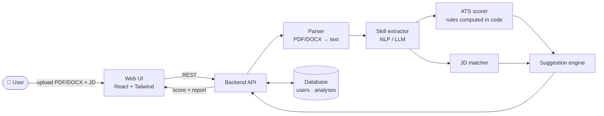
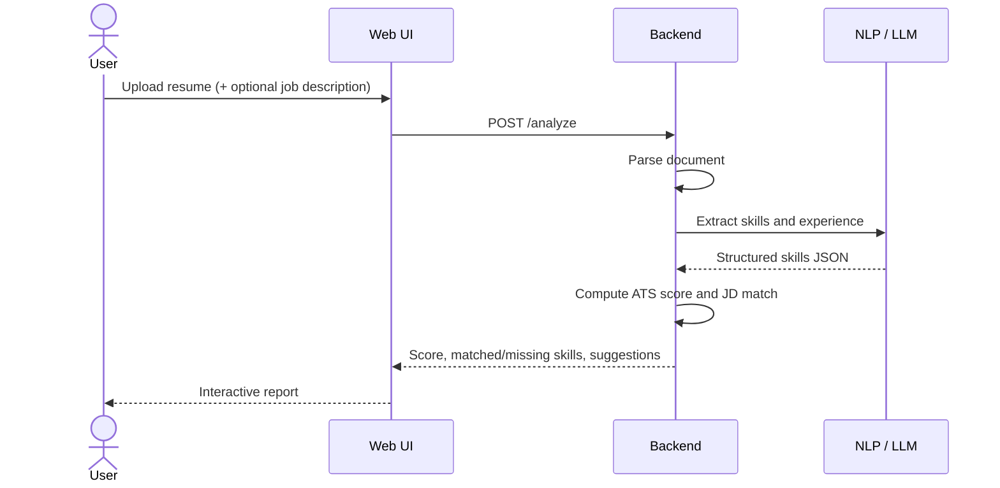

# 🧾 AI Resume Analyzer

**Upload a resume and get an ATS‑compatibility score, the skills it found, a match against a target role, and specific fixes.**

> [!NOTE]
> This repository holds the **design** for the project. The working implementation of these ideas lives in **[resume-compiler](https://github.com/arsheen2244/resume-compiler)**, an evidence‑checked resume analyzer built with Node.js, Express and a local Llama 3.2 model.

---

## ✨ Planned Features

| | Feature | What it means |
|:-:|--------|---------------|
| 📤 | **Resume upload & parsing** | PDF / DOCX → clean, structured text (sections, bullets, dates) |
| 📈 | **ATS score** | Formatting, keyword coverage and section completeness, scored 0–100 |
| 🧠 | **Skill extraction** | NLP / LLM pulls hard and soft skills and normalises synonyms (e.g. *JS* → *JavaScript*) |
| 🎯 | **Job‑role matching** | Compare against a job description: matched, missing and partially matched skills |
| 💡 | **Improvement suggestions** | Rewrite weak bullets with action verbs and measurable impact |
| 🔐 | **Accounts** | Sign in to keep a history of analyses |

## 🏗️ Proposed Architecture

## 🔄 User Flow

## 🧰 Candidate Tech Stack

| Layer | Options under consideration |
|------|----------------------------|
| Frontend | React / Next.js, Tailwind CSS |
| Backend | Flask (Python) or Node.js / Express |
| Database | PostgreSQL or MongoDB |
| AI / NLP | spaCy, an LLM API or a local model through Ollama, scikit‑learn |

## 🗺️ Roadmap

- [ ] Pick the stack and scaffold the frontend and backend
- [ ] PDF/DOCX parsing + skill extraction MVP
- [ ] ATS scoring rules + JD matching
- [ ] AI interview prep from the resume
- [ ] Real‑time job recommendations
- [ ] LinkedIn profile optimisation
- [ ] Multi‑language resumes
- [ ] Downloadable PDF report

---

Built by <a href="https://github.com/arsheen2244">Arsheen Inamdar</a>

